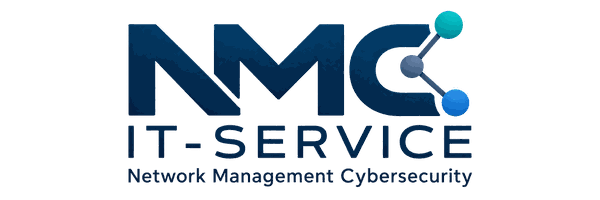

  

# NMC IT SERVICE

**Network · Management · Cybersecurity**

NMC IT SERVICE entwickelt und betreibt technische Lösungen rund um **IT-Service, Server & Infrastruktur, Web & Software sowie Cybersecurity**.

Seit **2012** im IT- und digitalen Umfeld aktiv, liegt der Fokus auf nachvollziehbaren, wartbaren und praxisnahen technischen Lösungen. Die heutige Marke **NMC IT SERVICE** führt die technische Arbeit weiter, die zuvor unter **MMC NETWORK** betrieben wurde.

## Wofür NMC steht

**NMC** steht für:

- **Network** – Netzwerke, DNS, Erreichbarkeit und technische Infrastruktur
- **Management** – strukturierter Betrieb, Administration, Automatisierung und nachvollziehbare Abläufe
- **Cybersecurity** – Systemhärtung, Berechtigungen, sichere Konfigurationen und kontrollierte Zugriffe

Dabei werden Server, Netzwerke, Anwendungen und Sicherheitsmaßnahmen nicht isoliert betrachtet, sondern als zusammenhängende technische Umgebung.

## Technische Schwerpunkte

### IT-Service & Systemadministration

- Linux- und Webserver
- System- und Dienstkonfiguration
- Benutzer- und Berechtigungskonzepte
- Updates, Wartung und Fehleranalyse
- dokumentierte und nachvollziehbare Betriebsabläufe

### Server & Infrastruktur

- Serverbetrieb und Webserver-Umgebungen
- Virtualisierung
- Container und reproduzierbare Anwendungsumgebungen
- Netzwerk- und DNS-Infrastruktur
- TLS/HTTPS und Zertifikate
- strukturierte Trennung und Verwaltung von Diensten

### Web & Software

- Webanwendungen
- individuelle Software
- APIs und Schnittstellen
- Automatisierung wiederkehrender Abläufe
- rollen- und berechtigungsbasierte Anwendungen
- wartbare und erweiterbare Projektstrukturen

### Cybersecurity

- Systemhärtung
- Reduzierung unnötiger Angriffsflächen
- Berechtigungs- und Zugriffskonzepte
- Segmentierung und kontrollierte administrative Zugänge
- Update-Strategien und technische Nachvollziehbarkeit

## Eigene Lösungen

### LicenseHub

**LicenseHub** ist eine von NMC IT SERVICE entwickelte Plattform zur zentralen Verwaltung von:

- Lizenzstatus und Laufzeiten
- Kunden- und Produktzuordnungen
- Software-Versionen
- Software-Updates
- technischen Schnittstellen zu angebundenen Systemen

Weitere Informationen: https://nmc-it-service.de/licensehub

### Dynamic DNS Server

Der **NMC Dynamic DNS Server** ist eine eigene Dynamic-DNS- und DNS-Verwaltung für verwaltete Hosts und Domains.

Unterstützt werden unter anderem:

- Verknüpfung eigener Domains
- verwaltete DynDNS-Hostnamen
- automatische Aktualisierung wechselnder IP-Adressen
- Benutzer- und Host-Zuordnungen
- nachvollziehbare Update-Aktivität
- administrierbare DNS-Funktionen

Unterstützte DNS-Record-Typen:

**A · AAAA · CNAME · TXT · MX · SRV · CAA**

Weitere Informationen: https://nmc-it-service.de/dynamic-dns

## Arbeitsweise

NMC IT SERVICE setzt auf technische Lösungen, die:

- verständlich aufgebaut sind
- nachvollziehbar dokumentiert werden können
- langfristig wartbar bleiben
- sich sauber erweitern lassen
- auf den tatsächlichen Einsatzzweck ausgerichtet sind

Nicht die Anzahl eingesetzter Produkte steht im Vordergrund, sondern eine technische Struktur, in der die einzelnen Komponenten zuverlässig zusammenarbeiten.

## Offizielle Website

### Deutsch

- Website: https://nmc-it-service.de
- IT-Service: https://nmc-it-service.de/it-service
- Server & Infrastruktur: https://nmc-it-service.de/server-infrastruktur
- Web & Software: https://nmc-it-service.de/web-software
- Cybersecurity: https://nmc-it-service.de/cybersecurity
- Eigene Lösungen: https://nmc-it-service.de/loesungen

### English

- Website: https://nmc-it-service.com
- IT Services: https://nmc-it-service.com/it-service
- Server & Infrastructure: https://nmc-it-service.com/server-infrastruktur
- Web & Software: https://nmc-it-service.com/web-software
- Cybersecurity: https://nmc-it-service.com/cybersecurity
- Solutions: https://nmc-it-service.com/loesungen

## Entwicklung auf GitHub

Die Entwicklungs-Repositories von NMC IT SERVICE sind überwiegend **privat**. Dieses öffentliche Organisationsprofil dient als offizielle GitHub-Präsenz und als Referenz für die Marke **NMC IT SERVICE**.

Private Repositories enthalten unter anderem die laufende Entwicklung eigener Software- und Infrastrukturprojekte. Quellcode, interne Systeme und nicht veröffentlichte Entwicklungsstände werden nicht öffentlich bereitgestellt.

---

# English

## NMC IT SERVICE

**Network · Management · Cybersecurity**

NMC IT SERVICE develops and operates technical solutions covering **IT services, server & infrastructure, web & software, and cybersecurity**.

Active in IT and digital technologies since **2012**, the focus is on understandable, maintainable and practical technical solutions. The current **NMC IT SERVICE** brand continues the technical work previously operated under **MMC NETWORK**.

## What NMC stands for

**NMC** stands for:

- **Network** – networks, DNS, connectivity and technical infrastructure
- **Management** – structured operations, administration, automation and traceable processes
- **Cybersecurity** – system hardening, permissions, secure configurations and controlled access

Servers, networks, applications and security measures are not treated as isolated components, but as one interconnected technical environment.

## Technical focus areas

### IT Services & System Administration

- Linux and web servers
- system and service configuration
- user and permission concepts
- updates, maintenance and troubleshooting
- documented and traceable operating processes

### Server & Infrastructure

- server operations and web server environments
- virtualization
- containers and reproducible application environments
- network and DNS infrastructure
- TLS/HTTPS and certificates
- structured separation and management of services

### Web & Software

- web applications
- custom software
- APIs and interfaces
- automation of recurring processes
- role- and permission-based applications
- maintainable and extensible project structures

### Cybersecurity

- system hardening
- reduction of unnecessary attack surfaces
- permission and access concepts
- segmentation and controlled administrative access
- update strategies and technical traceability

## Own solutions

### LicenseHub

**LicenseHub** is a platform developed by NMC IT SERVICE for the centralized management of:

- license status and validity periods
- customer and product assignments
- software versions
- software updates
- technical interfaces to connected systems

More information: https://nmc-it-service.com/licensehub

### Dynamic DNS Server

The **NMC Dynamic DNS Server** is an in-house Dynamic DNS and DNS management solution for managed hosts and domains.

Supported capabilities include:

- linking custom domains
- managed DynDNS hostnames
- automatic updating of changing IP addresses
- user and host assignments
- traceable update activity
- administrable DNS functions

Supported DNS record types:

**A · AAAA · CNAME · TXT · MX · SRV · CAA**

More information: https://nmc-it-service.com/dynamic-dns

## How we work

NMC IT SERVICE focuses on technical solutions that:

- are structured in an understandable way
- can be documented transparently
- remain maintainable over the long term
- can be extended cleanly
- are aligned with their actual purpose of use

The focus is not on the number of products used, but on a technical structure in which the individual components work together reliably.

## Official website

### German

- Website: https://nmc-it-service.de
- IT Service: https://nmc-it-service.de/it-service
- Server & Infrastructure: https://nmc-it-service.de/server-infrastruktur
- Web & Software: https://nmc-it-service.de/web-software
- Cybersecurity: https://nmc-it-service.de/cybersecurity
- Own solutions: https://nmc-it-service.de/loesungen

### English

- Website: https://nmc-it-service.com
- IT Services: https://nmc-it-service.com/it-services
- Server & Infrastructure: https://nmc-it-service.com/server-infrastructure
- Web & Software: https://nmc-it-service.com/web-software
- Cybersecurity: https://nmc-it-service.com/cybersecurity
- Solutions: https://nmc-it-service.com/solutions

## Development on GitHub

The development repositories of NMC IT SERVICE are predominantly **private**. This public organization profile serves as the official GitHub presence and as a reference for the **NMC IT SERVICE** brand.

Private repositories include, among other things, the ongoing development of proprietary software and infrastructure projects. Source code, internal systems and unpublished development states are not made publicly available.
